<div align="center">
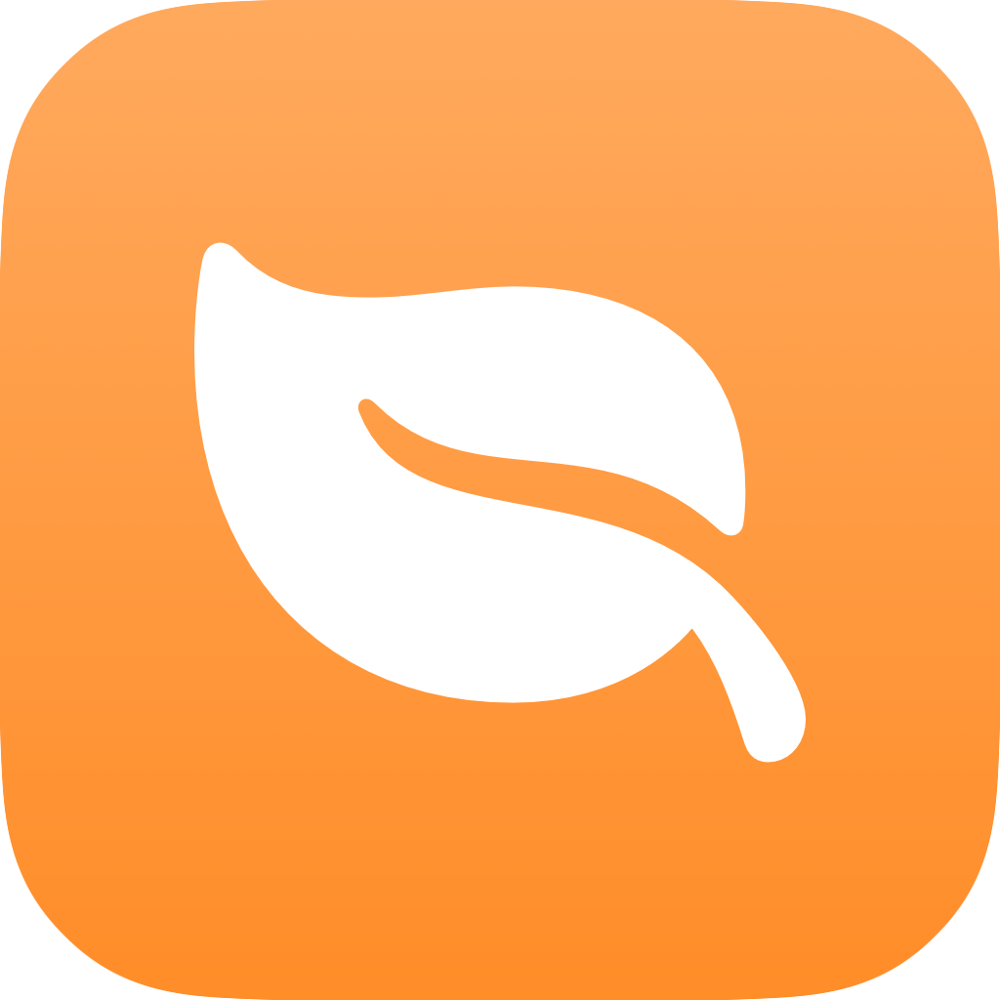

# Tick Rest

<p>
  <a href="https://github.com/fthux/tick-rest-macos/commits/master/"></a>
  <a href="LICENSE"></a>
  <a href="https://sonarcloud.io/summary/new_code?id=fthux_tick-rest-macos"></a>
  <a href="https://sonarcloud.io/summary/new_code?id=fthux_tick-rest-macos"></a>
</p>

<p>
  <a href="https://sonarcloud.io/summary/new_code?id=fthux_tick-rest-macos"></a>
<!-- [](https://sonarcloud.io/summary/new_code?id=fthux_tick-rest-macos) -->
  <a href="https://sonarcloud.io/summary/new_code?id=fthux_tick-rest-macos"></a>
  <a href="https://sonarcloud.io/summary/new_code?id=fthux_tick-rest-macos"></a>
  <a href="https://deepwiki.com/fthux/tick-rest-macos"></a>
</p>

  English | [简体中文](README.zh-CN.md)
</div>

<p align="center">
  Yet another break time reminder app<br />
  <strong>Native experience · Compact bundle · High performance</strong><br />
  Take regular breaks from your computer to rest your eyes, relax, and walk around.
</p>

<p align="center">
  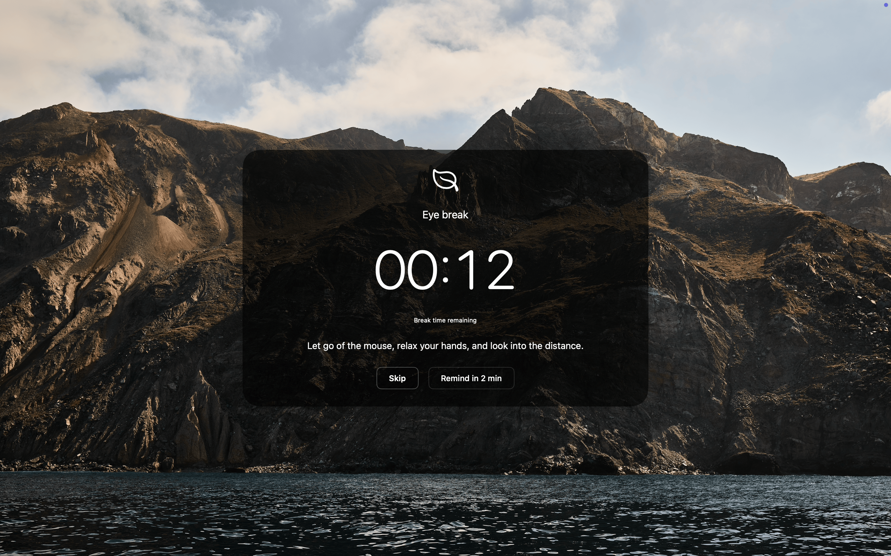
</p>

## Why Tick Rest?

- **Native experience** — Developed with Swift, SwiftUI, and AppKit.
- **Compact bundle** — No bundled browser engine or extra runtime from frameworks like Electron, keeping the app lightweight.
- **High performance** — Native compilation and rendering minimize overhead for excellent performance.
- **Mult choices of break schedules** — Built-in presets include eye care, 50/10, and Pomodoro, with customizable break intervals, durations, and snooze options.
- **Flexible reminders** — Choose windowed or full-screen reminders. Full-screen mode supports multiple displays and lets you pick a solid color, gradient, or image as the background.
- **Flexible settings** — Set your working hours, enable idle detection, and defer reminders while using full-screen apps. Pause reminders or start a break at any time from the menu bar.
- **Private by design** — No account required and no ads. Your settings and break history are stored locally on your Mac.
- **A familiar interface** — Supports light and dark appearances and is available in English, Simplified Chinese, Traditional Chinese, Japanese, and Korean.

## Tick Rest for Windows

Looking for a Windows version? I’m building a native Windows app for Tick Rest. Stay tuned!

## Installation

> Tick Rest is a free, independently maintained open-source project. To keep annual costs manageable, I have not joined the Apple Developer Program. The app is therefore not Developer ID–signed or notarized.

**Homebrew (recommended):**

```bash
brew install --cask fthux/tap/tickrest
```

**Manual installation:**

Download the ZIP file for your Mac from the [releases page](https://github.com/fthux/tick-rest-macos/releases), unzip it, and drag Tick Rest into your Applications folder. Choose `arm64` for Apple Silicon or `x86_64` for Intel. The `universal` build works on both.

> [!IMPORTANT]
> The first time you open Tick Rest, macOS **Gatekeeper** may prevent it from opening and display a warning that the developer cannot be verified. After checking that your copy came from this project's releases page, go to **System Settings → Privacy & Security**, click **Open Anyway**, and confirm that you want to open the app. See [Apple's guide](https://support.apple.com/en-us/102445) for details.

## Getting Started

1. Open Tick Rest and choose your break schedule and reminder style during the initial setup.
2. You're all set!
3. To personalize your experience, adjust your preferences in Settings.

## Screenshots

### Windowed Reminders

Choose from three sizes—Standard, Small, and Mini—or collapse the reminder so it takes up less space on your screen.

<table>
  <tr>
    <th>Standard</th>
    <th>Small</th>
    <th>Mini</th>
  </tr>
  <tr>
    <td align="center" valign="middle"><a href="screenshots/reminder-card-normal.png">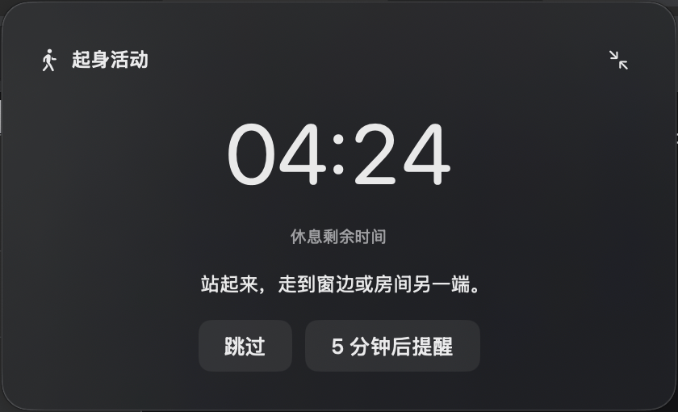</a></td>
    <td align="center" valign="middle"><a href="screenshots/reminder-card-small.png">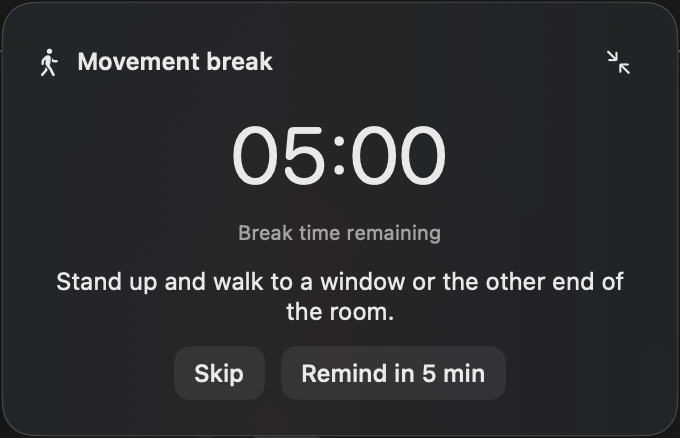</a></td>
    <td align="center" valign="middle"><a href="screenshots/reminder-card-mini.png">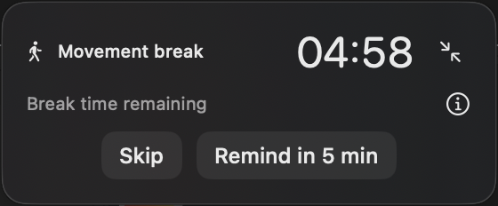</a></td>
  </tr>
</table>

<p align="center">
  <b>Collapsed</b><br />
  <a href="screenshots/reminder-card-callapse.png">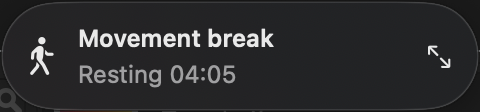</a>
</p>

### Full-Screen Reminders

Use a solid color, gradient, or image as your break background. Full-screen reminders support multiple displays.

<table>
  <tr>
    <th>Solid Color</th>
    <th>Gradient</th>
    <th>Image</th>
  </tr>
  <tr>
    <td align="center" valign="middle"><a href="screenshots/fullscreen-solid-color.png">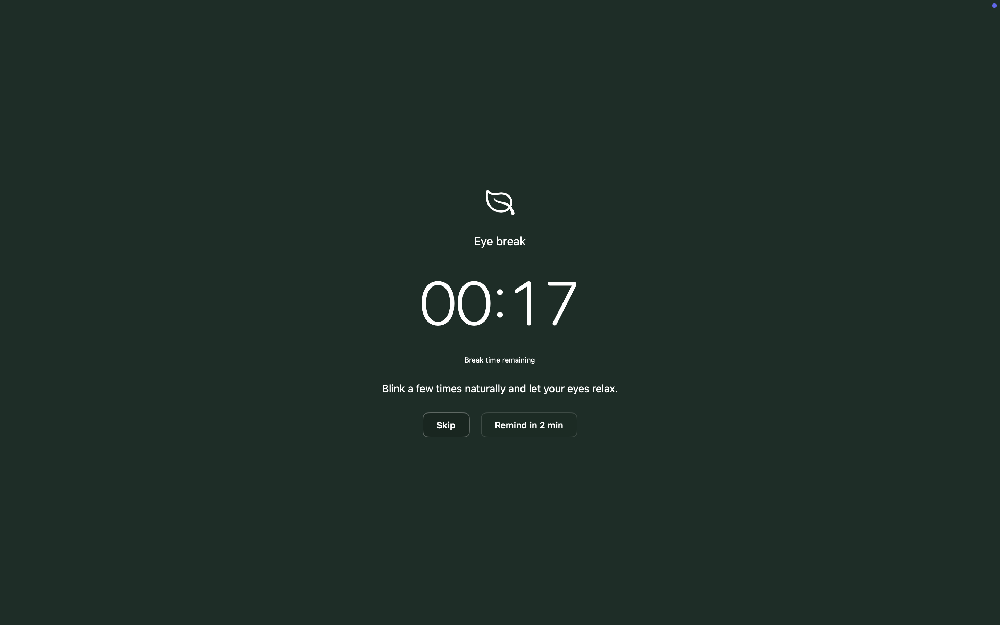</a></td>
    <td align="center" valign="middle"><a href="screenshots/fullscreen-gradient.png">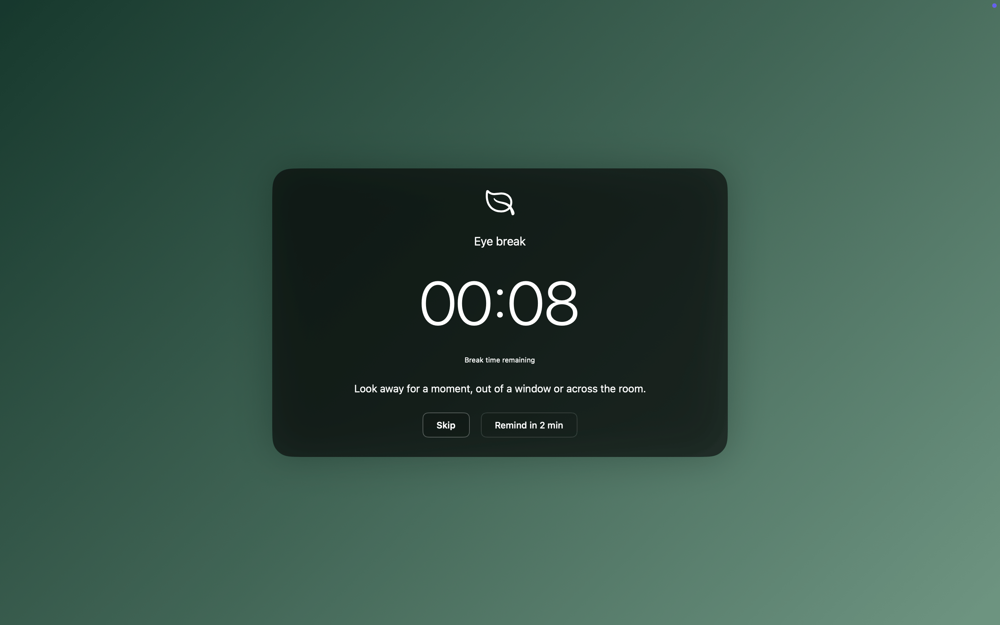</a></td>
    <td align="center" valign="middle"><a href="screenshots/fullscreen-wallpaper.png"></a></td>
  </tr>
</table>

### Menu Bar

See how long until your next break, take a break right away, or pause and resume reminders—all from the menu bar.

<p align="center">
  <a href="screenshots/menu-items.png">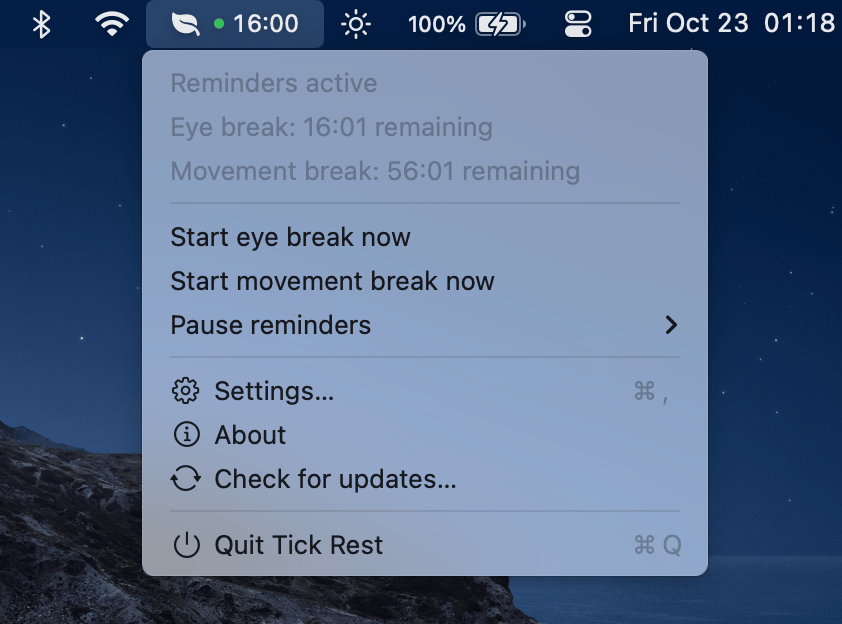</a>
</p>

### App Overview

<table>
  <tr>
    <th>General Settings</th>
    <th>Break Schedules</th>
    <th>Working Hours</th>
  </tr>
  <tr>
    <td align="center" valign="middle"><a href="screenshots/1_mix.png">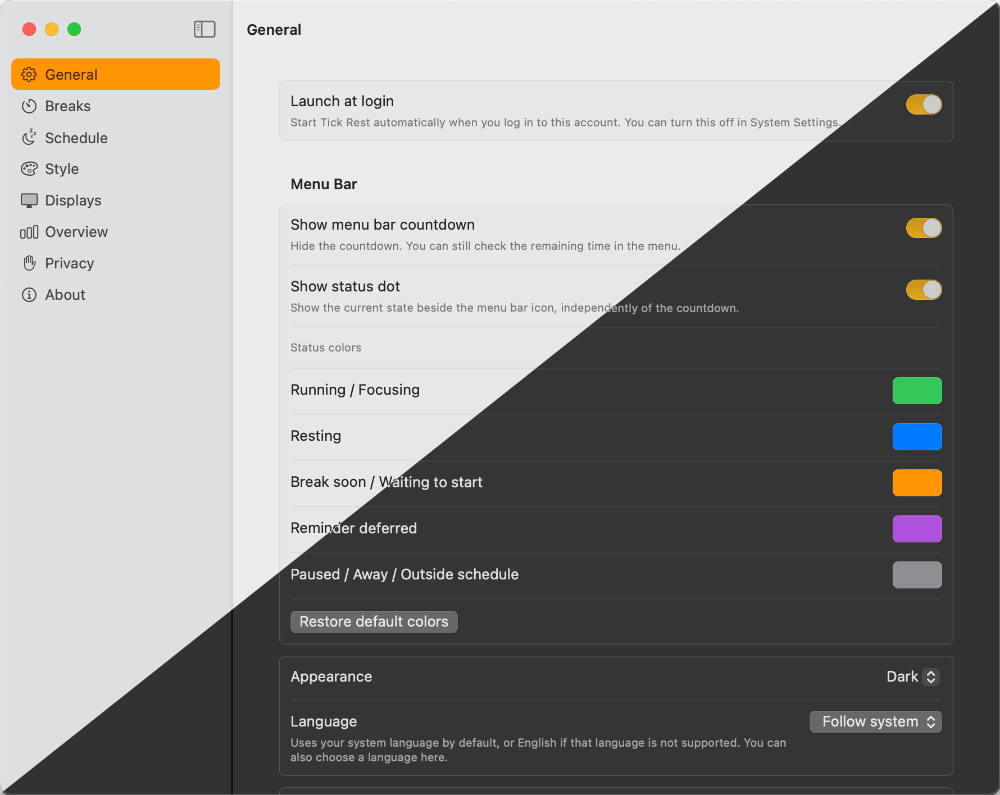</a></td>
    <td align="center" valign="middle"><a href="screenshots/2_mix.png">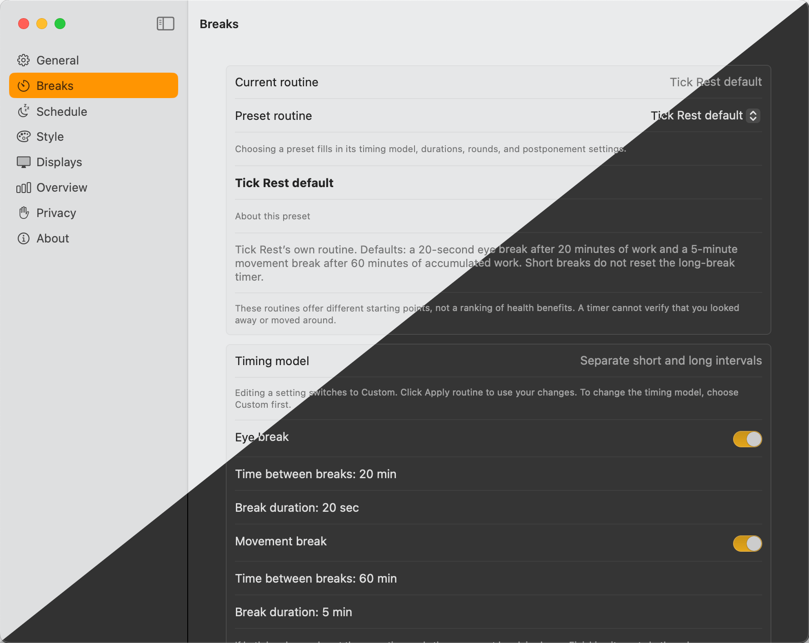</a></td>
    <td align="center" valign="middle"><a href="screenshots/3_mix.png">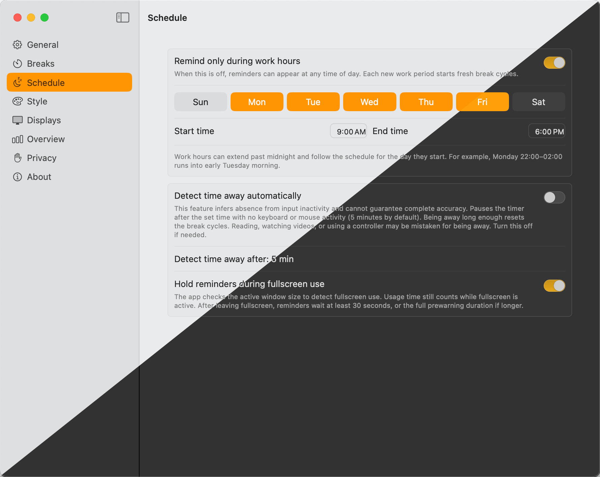</a></td>
  </tr>
  <tr>
    <th>Windowed Reminders</th>
    <th>Full-Screen Background: Gradient</th>
    <th>Full-Screen Background: Image</th>
  </tr>
  <tr>
    <td align="center" valign="middle"><a href="screenshots/4_mix.png">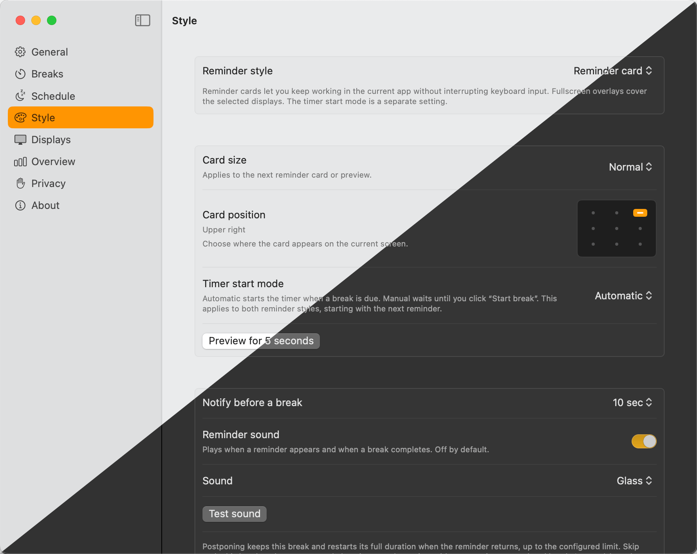</a></td>
    <td align="center" valign="middle"><a href="screenshots/5_mix.png">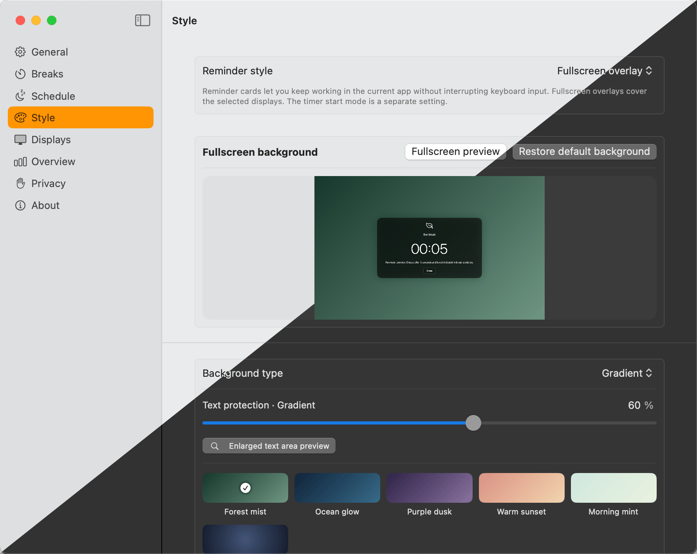</a></td>
    <td align="center" valign="middle"><a href="screenshots/6_mix.png">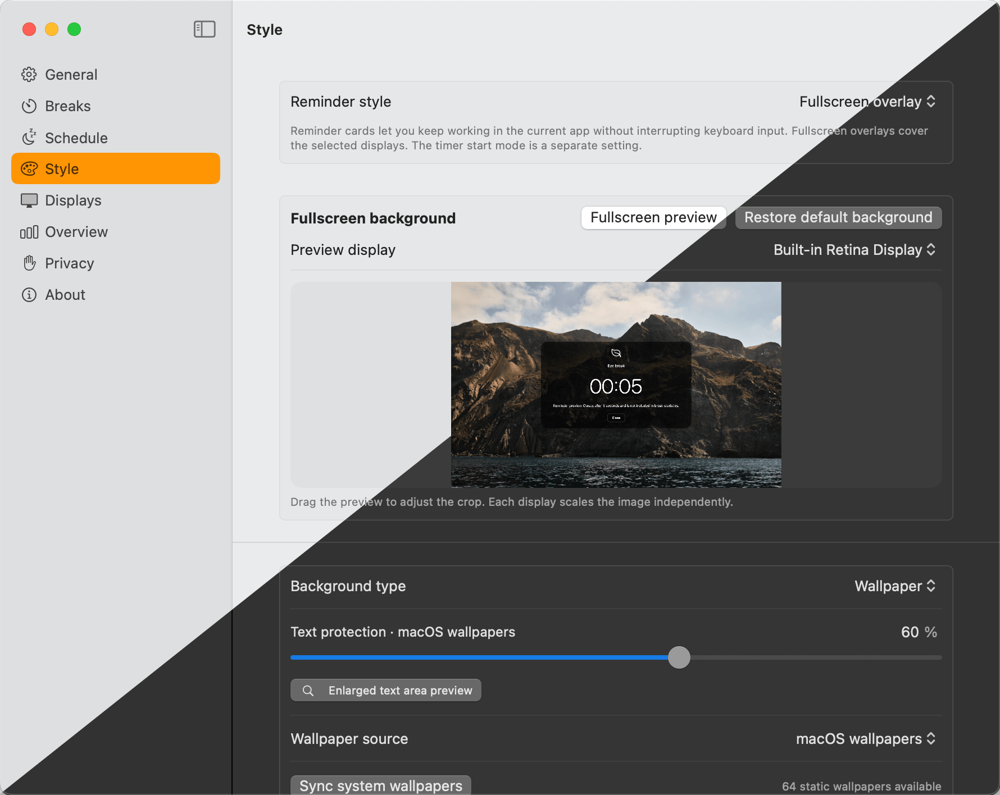</a></td>
  </tr>
  <tr>
    <th>Display Settings</th>
    <th>Break Statistics</th>
    <th>About Tick Rest</th>
  </tr>
  <tr>
    <td align="center" valign="middle"><a href="screenshots/7_mix.png">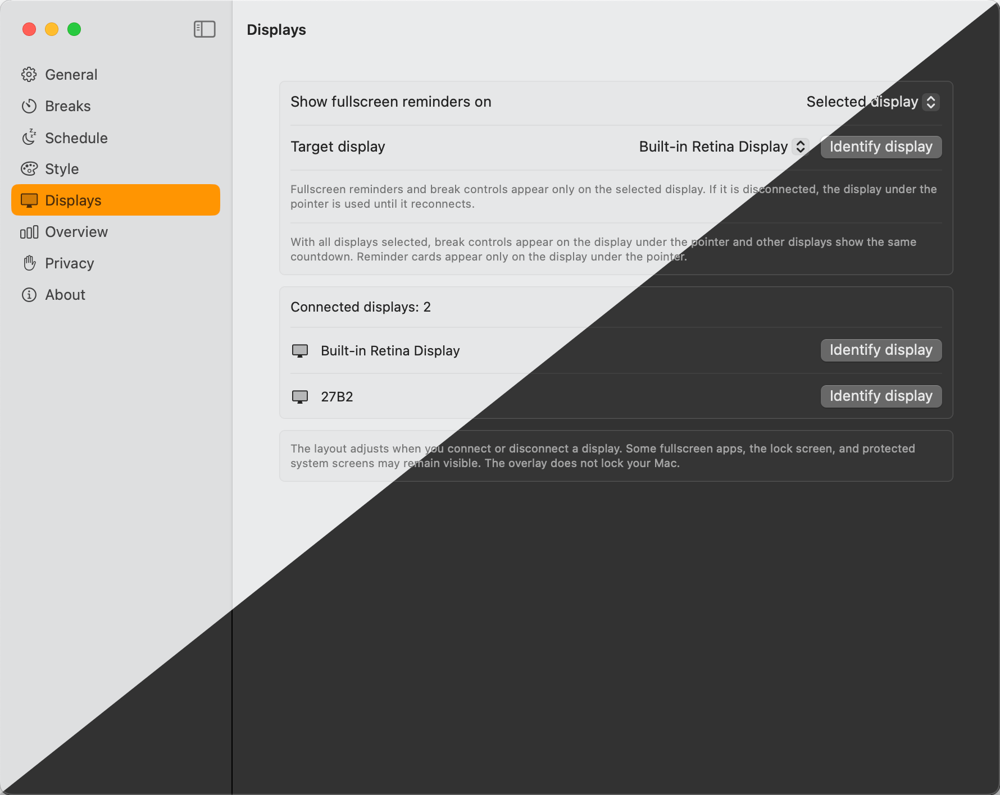</a></td>
    <td align="center" valign="middle"><a href="screenshots/8_mix.png">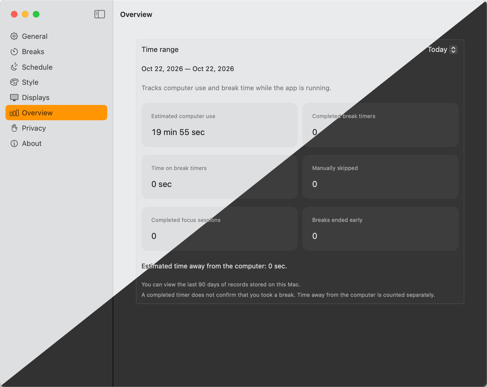</a></td>
    <td align="center" valign="middle"><a href="screenshots/9_mix.png">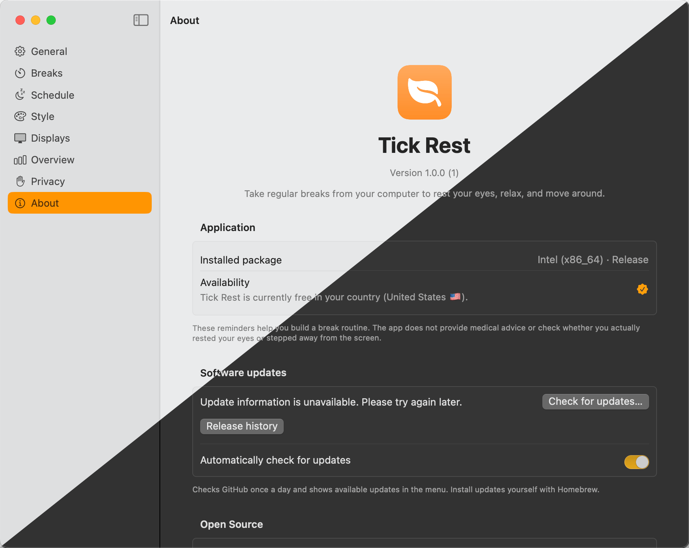</a></td>
  </tr>
</table>

## Permissions

- **Notifications (optional):** Get a heads-up before a break and a notification when an app update is complete. Tick Rest works normally even if you don't allow notifications.
- **Launch at login (optional):** If you turn this on, macOS may ask you to allow Tick Rest to run at login in **Login Items**.

## Requirements

Requires macOS 13 (Ventura) or later. Runs on both Apple Silicon and Intel Macs.

## License

[AGPLv3](LICENSE)
